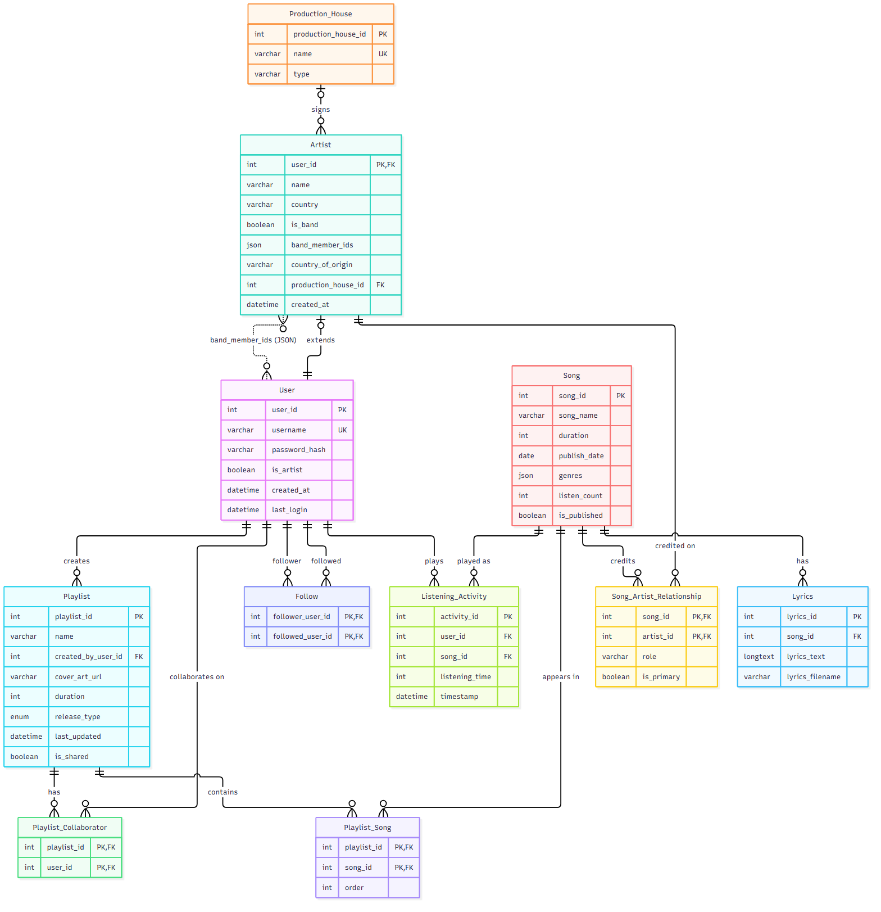
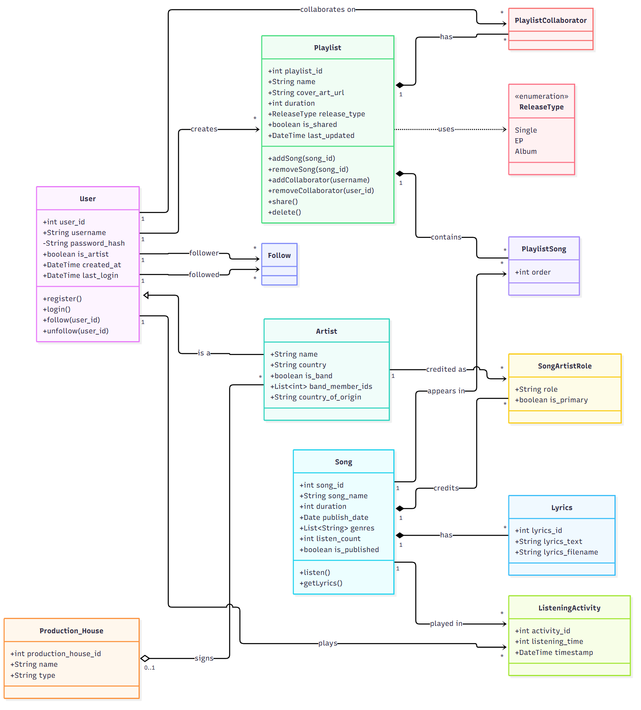

# MusicLib: Music Library Management System

A full-stack web application on an 11-table MySQL database. Users browse songs and artists, build and share playlists, collaborate on them, follow each other, read lyrics and see what they played recently. Course project for 22AIE303 Database Management Systems.

**Contents**

1. [Team](#1-team)
2. [Overview and problem statement](#2-overview-and-problem-statement)
3. [System requirements and architecture](#3-system-requirements-and-architecture)
4. [ER diagram and UML diagram](#4-er-diagram-and-uml-diagram)
5. [Relational schema mapping](#5-relational-schema-mapping)
6. [Normalization and functional dependencies](#6-normalization-and-functional-dependencies)
7. [Methodology and database design](#7-methodology-and-database-design)
8. [Advanced SQL queries and their purpose](#8-advanced-sql-queries-and-their-purpose)
9. [Installation, setup and execution](#9-installation-setup-and-execution)
10. [Demonstration: run the project and reproduce the database state](#10-demonstration-run-the-project-and-reproduce-the-database-state)
11. [Reference: API, environment variables, project layout](#11-reference)

---

## 1. Team

| Name | Roll number |
| --- | --- |
| Abhinav Variyath | CB.SC.U4AIE24002 |
| Tara Samiksha | CB.SC.U4AIE24045 |
| Niranjan S | CB.SC.U4AIE24046 |
| Prajit T | CB.SC.U4AIE24062 |

Team number: 1

---

## 2. Overview and problem statement

**What it does.** MusicLib gives listeners and artists one place to find music, organise it into playlists and work on those playlists together.

- Register as a listener or an artist (artists get a profile with country, label and band members).
- Search songs by name and genre, read lyrics, and log a listen.
- Create, edit, share and delete playlists. Artists can mark a playlist as a Single, EP or Album.
- Add collaborators by username; collaborators can add and remove songs.
- Follow users and artists; the dashboard shows a "recently played" list.

**Problem statement.** Music data is relational by nature. A song has several credited artists, an artist belongs to a label or a band, a playlist has an owner and collaborators, and users follow each other. Keeping this in files or spreadsheets duplicates names and breaks the links between these facts, so the data becomes inconsistent and cannot be queried across. The project asks how to model this domain so it stays consistent, can be queried flexibly, and supports a real multi-user application.

**Objectives**

- Design a relational schema with explicit keys and delete rules, and justify it with functional dependencies and normal forms.
- Query it with joins, subqueries, window functions, recursive CTEs and JSON functions.
- Serve it through a REST API and a web interface with login, search, playlist editing, sharing and following.

---

## 3. System requirements and architecture

### Requirements

| To run | You need |
| --- | --- |
| The whole system (recommended) | Docker Desktop (Windows, macOS) or Docker Engine (Linux) with Docker Compose v2 (`docker compose`), and Git |
| Free host ports | 5273 (website), 3101 (API), 3407 (MySQL, bound to 127.0.0.1) |
| Without Docker (optional) | Python 3.12, Node.js 20, MySQL 8.0 |

Libraries are pinned or ranged in `backend/requirements.txt` and `frontend/package.json`.

| Layer | Technology |
| --- | --- |
| Database | MySQL 8.0, InnoDB, `utf8mb4_unicode_ci`, plain SQL through PyMySQL (no ORM) |
| Back end | Python 3.12, FastAPI, Uvicorn, JWT login (PyJWT), bcrypt password hashing |
| Front end | React 18, TypeScript, Vite, Tailwind CSS, shadcn/ui (Radix), Axios |
| Deployment | Docker Compose, three containers |

### Architecture

```text
 Browser
   |  http://localhost:5273
   v
 +-----------------------------+
 | frontend  (React, Vite)     |   serves the UI and proxies /api/* to the back end
 +-----------------------------+
   |  /api/*  (JSON, Bearer JWT)
   v
 +-----------------------------+
 | backend   (FastAPI)         |   http://localhost:3101  (health: /health)
 |  routes -> SQL -> PyMySQL   |   creates missing tables and loads demo data on start
 +-----------------------------+
   |  SQL over TCP
   v
 +-----------------------------+
 | db        (MySQL 8)         |   127.0.0.1:3407, data in the mysql_data volume
 +-----------------------------+
```

- The back end waits for MySQL, runs `backend/db/schema.sql` (`CREATE TABLE IF NOT EXISTS`) and then `backend/db/seed.sql`, so a fresh start always reaches the same database state.
- Each request opens one connection, does its work in a transaction, and commits before it answers.
- Login returns a JWT (7 days). Every other endpoint needs `Authorization: Bearer <token>`.

---

## 4. ER diagram and UML diagram

### ER diagram

All 11 tables with their keys (`PK` primary, `FK` foreign, `UK` unique). The dotted line between Artist and User is the JSON list `band_member_ids`, which has no foreign key.



Mermaid source: [docs/er-diagram.mmd](docs/er-diagram.mmd)

### UML class diagram

The classes mirror the tables. The link tables appear as classes because they carry keys or attributes. Operations are the actions the REST API offers. Artist is drawn as a specialisation of User because it shares User's primary key.



Mermaid source: [docs/uml-class-diagram.mmd](docs/uml-class-diagram.mmd)

---

## 5. Relational schema mapping

### Mapping rules used

| ER construct | Becomes |
| --- | --- |
| Entity | A table with a surrogate integer key (`AUTO_INCREMENT`); natural keys such as `username` stay `UNIQUE` |
| Specialisation (Artist is a User) | `Artist.user_id` is both primary key and foreign key to `User` |
| One-to-many | A foreign key on the "many" side (`Playlist.created_by_user_id`, `Lyrics.song_id`, nullable `Artist.production_house_id`) |
| Many-to-many | A link table with a composite primary key (`Playlist_Song`, `Playlist_Collaborator`, `Song_Artist_Relationship`) |
| Recursive many-to-many (User follows User) | `Follow` with two foreign keys to `User` |
| Repeatable event (a user plays a song many times) | `Listening_Activity` with its own surrogate key |
| Relationship attribute | A column of the link table (`order`, `role`, `is_primary`) |

### Relations

`*` marks a primary-key attribute, `->` a foreign key and the relation it references.

```text
User(user_id*, username [unique], password_hash, is_artist, created_at, last_login)
Production_House(production_house_id*, name [unique], type)
Artist(user_id*->User, name, country, is_band, band_member_ids, country_of_origin,
       production_house_id->Production_House, created_at)
Song(song_id*, song_name, duration, publish_date, genres, listen_count, is_published)
Song_Artist_Relationship(song_id*->Song, artist_id*->Artist, role, is_primary)
Playlist(playlist_id*, name, created_by_user_id->User, cover_art_url, duration,
         release_type, last_updated, is_shared)
Playlist_Song(playlist_id*->Playlist, song_id*->Song, order)
Playlist_Collaborator(playlist_id*->Playlist, user_id*->User)
Follow(follower_user_id*->User, followed_user_id*->User)
Listening_Activity(activity_id*, user_id->User, song_id->Song, listening_time, timestamp)
Lyrics(lyrics_id*, song_id->Song, lyrics_text, lyrics_filename)
```

### Foreign keys and delete actions

The schema has 11 relations and 14 foreign keys. Every foreign key also has `ON UPDATE CASCADE`.

| Child column | Parent | On delete |
| --- | --- | --- |
| `Artist.user_id` | `User.user_id` | CASCADE |
| `Artist.production_house_id` | `Production_House.production_house_id` | SET NULL |
| `Song_Artist_Relationship.song_id` | `Song.song_id` | CASCADE |
| `Song_Artist_Relationship.artist_id` | `Artist.user_id` | CASCADE |
| `Playlist.created_by_user_id` | `User.user_id` | RESTRICT |
| `Playlist_Song.playlist_id`, `.song_id` | `Playlist`, `Song` | CASCADE |
| `Playlist_Collaborator.playlist_id`, `.user_id` | `Playlist`, `User` | CASCADE |
| `Follow.follower_user_id`, `.followed_user_id` | `User` | CASCADE |
| `Listening_Activity.user_id`, `.song_id` | `User`, `Song` | RESTRICT |
| `Lyrics.song_id` | `Song.song_id` | RESTRICT |

Other constraints: `User.username` and `Production_House.name` are unique; `Artist.country` has an index; `Playlist.release_type` accepts only `Single`, `EP`, `Album` or `NULL`. The full DDL is in [backend/db/schema.sql](backend/db/schema.sql).

---

## 6. Normalization and functional dependencies

The functional dependencies (FDs) come from the business rules, not from the sample data, because data can disprove an FD but never prove one. Every table is in BCNF for its declared keys, except two JSON list columns that break strict first normal form.

| Table | Candidate keys | Functional dependencies | Normal form |
| --- | --- | --- | --- |
| User | `user_id`; `username` | `user_id` -> all other columns; `username` -> `user_id` | BCNF |
| Production_House | `production_house_id`; `name` | `production_house_id` -> `name`, `type`; `name` -> `production_house_id` | BCNF |
| Artist | `user_id` | `user_id` -> all other columns | 1NF broken by `band_member_ids` |
| Song | `song_id` | `song_id` -> all other columns | 1NF broken by `genres` |
| Song_Artist_Relationship | `(song_id, artist_id)` | `(song_id, artist_id)` -> `role`, `is_primary` | BCNF |
| Playlist | `playlist_id` | `playlist_id` -> all other columns | BCNF |
| Playlist_Song | `(playlist_id, song_id)` | `(playlist_id, song_id)` -> `order` | BCNF |
| Playlist_Collaborator, Follow | both columns together | none (every column is in the key) | BCNF |
| Listening_Activity, Lyrics | `activity_id`, `lyrics_id` | key -> all other columns | BCNF |

### How each normal form was checked

- **1NF:** each column must hold one atomic value. Only the two JSON lists fail.
- **Keys:** the attribute closure of `{song_id, artist_id}` reaches all four columns of `Song_Artist_Relationship`, and neither column alone reaches `role`, so the pair is a key. MySQL enforces every key with `PRIMARY KEY` or `UNIQUE`.
- **2NF** (composite keys only: `Song_Artist_Relationship`, `Playlist_Song`): no non-key column may depend on part of the key. In the data, `role` is not fixed by `song_id` alone ("Sol y Sombra" has a Main Artist and a Featured Artist), nor by `artist_id` alone (Gina Okafor is Main Artist on "Lagos Nights" and Featured Artist on "Sol y Sombra"). These real rows are counterexamples to both partial dependencies.
- **3NF and BCNF:** in every table the left side of each FD is a primary or unique key, so no non-key column determines another. Facts about users, songs and labels live in their own tables and are referenced by key.
- **4NF:** the link tables hold no independent multi-valued facts.

### The two 1NF violations

`Song.genres` (for example `["Pop", "Synthwave"]`) and `Artist.band_member_ids` (for example `[1, 2, 3]`) store a list in one cell. A foreign key cannot check the ids inside a list, and finding every Pop song means parsing text. The proposed fix, not applied because the application reads each list whole:

```sql
CREATE TABLE Song_Genre (
    song_id INT NOT NULL,
    genre   VARCHAR(50) NOT NULL,
    PRIMARY KEY (song_id, genre),
    FOREIGN KEY (song_id) REFERENCES Song (song_id) ON DELETE CASCADE
);
CREATE TABLE Band_Member (
    band_user_id   INT NOT NULL,
    member_user_id INT NOT NULL,
    PRIMARY KEY (band_user_id, member_user_id),
    FOREIGN KEY (band_user_id)   REFERENCES Artist (user_id) ON DELETE CASCADE,
    FOREIGN KEY (member_user_id) REFERENCES User (user_id)   ON DELETE CASCADE
);
```

`JSON_TABLE` (query Q4 and Q5 in section 8) gives a first-normal-form view of both lists without changing the tables.

### Stored values that can be calculated

`Playlist.duration` (sum of its songs), `Song.listen_count` (count of logged plays) and `User.is_artist` (an `Artist` row exists) repeat facts held elsewhere. They do not break BCNF, which looks at one table at a time, but they can go stale. The back end recalculates `Playlist.duration` whenever songs are added or removed, and query Q10 audits it.

---

## 7. Methodology and database design

1. **Requirements.** List what users must do: register, search, build and share playlists, collaborate, follow, play and read lyrics.
2. **Conceptual design.** Identify seven entities and their relationships and cardinalities (section 5). Draw the ER diagram.
3. **Logical design.** Map the model to 11 relations with keys and delete rules. Artist extends User; the four many-to-many relationships become link tables.
4. **Normalization.** Write the FDs, find keys by closure, and check 1NF to BCNF table by table (section 6). Record the two violations and their fixes.
5. **Implementation.**
   - `backend/db/schema.sql` creates the tables and is safe to run on every start.
   - `backend/db/seed.sql` loads demo data with `INSERT IGNORE` and `NOT EXISTS`, so re-running it never duplicates rows.
   - FastAPI routes use parameterised SQL; multi-step changes run in one transaction (for example, adding a song locks the playlist row with `FOR UPDATE`).
   - The React front end calls the API through a single `/api` proxy.
6. **Verification.** The schema and seed were tested twice on a throwaway database; row counts were compared with the expected counts in section 10, and every query in `docs/advanced_queries.sql` was run without errors. The code was reviewed against the schema, which fixed unpublished songs showing on artist pages, a genre filter that matched "Pop" inside "Synthpop", and a Following count capped at 5, and connected the `Lyrics` and `Listening_Activity` tables to the interface.

**Design decisions**

- Artist extends User, so listeners carry no empty artist columns and one login serves both roles.
- Composite primary keys on link tables stop a song being added to a playlist twice or a user being followed twice.
- One `Playlist` table also serves as Single, EP and Album through the nullable `release_type`.
- Delete rules protect history: a user who owns playlists or has plays cannot be deleted by accident (`RESTRICT`), while link rows disappear with their parent (`CASCADE`).
- JSON columns were kept for genres and band members for speed of development; section 6 lists the cost and the fix.

---

## 8. Advanced SQL queries and their purpose

All 12 queries are in [docs/advanced_queries.sql](docs/advanced_queries.sql). The project defines no views, triggers or stored procedures; consistency comes from keys, delete rules and transactions.

| Query | Technique | Purpose |
| --- | --- | --- |
| Q1 | Four-table join with `LEFT JOIN` | Most-played songs with artist and label; keeps artists without a label |
| Q2 | `GROUP BY`, `HAVING`, aggregates | Label performance: artists, credits and total listens per label |
| Q3 | Correlated subqueries, `EXISTS` | Playlists a user owns or collaborates on, with song and collaborator counts (the API's playlist list) |
| Q4 | `JSON_TABLE`, CTE, `RANK()` | Best song in each genre, unpacking the JSON genre list |
| Q5 | `JSON_TABLE` plus join | Band members as usernames, replacing the missing foreign key |
| Q6 | Self join | Pairs of users who follow each other |
| Q7 | Recursive CTE | Who a user reaches within two follows |
| Q8 | Window function `SUM() OVER` | Running time of a playlist song by song |
| Q9 | Anti-join (`LEFT JOIN ... IS NULL`) | Published songs that were never played |
| Q10 | Audit with a correlated subquery | Stored playlist duration versus the recomputed sum (no rows when consistent) |
| Q11 | Join and `GROUP BY` | `listen_count` versus the number of logged plays |
| Q12 | Pre-aggregated derived tables | Per-user playlists, follows and listening time without join fan-out |

Output below is from a fresh install of the demo data (section 10).

**Q4. Best song per genre**

```sql
WITH song_genre AS (
    SELECT s.song_id, s.song_name, s.listen_count, jt.genre
    FROM Song s, JSON_TABLE(s.genres, '$[*]' COLUMNS (genre VARCHAR(50) PATH '$')) jt
    WHERE s.is_published = 1
), ranked AS (
    SELECT genre, song_name, listen_count,
           RANK() OVER (PARTITION BY genre ORDER BY listen_count DESC) AS rnk
    FROM song_genre
)
SELECT genre, song_name, listen_count FROM ranked WHERE rnk = 1
ORDER BY listen_count DESC LIMIT 5;
```

| genre | song_name | listen_count |
| --- | --- | --- |
| Electronic | Electric Horizon | 49307 |
| Dance | Electric Horizon | 49307 |
| Pop | Lagos Nights | 41276 |
| Afrobeats | Lagos Nights | 41276 |
| Rock | Storm Rider | 39422 |

**Q7. Who hannah reaches within two follows**

```sql
WITH RECURSIVE reach AS (
    SELECT followed_user_id AS user_id, 1 AS depth
    FROM Follow WHERE follower_user_id = (SELECT user_id FROM User WHERE username = 'hannah')
    UNION
    SELECT f.followed_user_id, r.depth + 1
    FROM reach r JOIN Follow f ON f.follower_user_id = r.user_id
    WHERE r.depth < 2
)
SELECT u.username, MIN(r.depth) AS hops
FROM reach r JOIN User u ON u.user_id = r.user_id
WHERE u.username <> 'hannah'
GROUP BY u.user_id, u.username
ORDER BY hops, u.username;
```

| username | hops |
| --- | --- |
| alice | 1 |
| charlie | 1 |
| diana | 1 |
| bob | 2 |

**Adding a song to a playlist** is one transaction in the back end. The row lock stops two simultaneous adds from taking the same position.

```sql
SELECT playlist_id FROM Playlist WHERE playlist_id = :pid FOR UPDATE;
SELECT COALESCE(MAX(`order`), 0) + 1 FROM Playlist_Song WHERE playlist_id = :pid;
INSERT INTO Playlist_Song (playlist_id, song_id, `order`) VALUES (:pid, :sid, :next);
UPDATE Playlist SET last_updated = NOW(3), duration =
  (SELECT COALESCE(SUM(s.duration), 0) FROM Playlist_Song ps
   JOIN Song s ON s.song_id = ps.song_id WHERE ps.playlist_id = :pid)
WHERE playlist_id = :pid;
COMMIT;
```

---

## 9. Installation, setup and execution

### Quick start (Docker)

1. Clone the repository and enter it.

   ```bash
   git clone <your-repo-url>
   cd <repo-folder>
   ```

2. Create the environment file.

   ```bash
   cp .env.example .env
   ```

   On Windows PowerShell use `copy .env.example .env`.

3. Edit `.env` and set `MYSQL_ROOT_PASSWORD` and `JWT_SECRET` (the back end refuses to start without a JWT secret). Keep the password URL-safe (letters and digits). The other values can stay as they are.

4. Build and start everything.

   ```bash
   docker compose up -d --build
   ```

5. Check that it is healthy. `musiclib_py_backend` should show `healthy`, the logs should say `Schema ready` and `Demo data ready`, and the health call should return `{"status":"ok",...}`.

   ```bash
   docker compose ps
   docker compose logs backend
   curl http://localhost:3101/health
   ```

6. Open the app.

   | Service | URL |
   | --- | --- |
   | Website | http://localhost:5273 |
   | API | http://localhost:3101 |
   | MySQL | 127.0.0.1:3407 (host only) |

Log in as `alice` with password `password123` (see section 10 for all demo accounts).

### Stop, restart and clean up

```bash
docker compose stop            # stop, keep the data
docker compose up -d           # start again
docker compose down            # remove containers, keep the database volume
docker compose down -v         # remove containers AND the database (full reset)
```

### Other ways to run

- **Linux VM (Ubuntu or Debian, including Azure):** `bash setup-vm.sh --skip-clone` from inside the cloned repo installs Docker, writes `.env` with generated secrets and starts the stack. Step-by-step Windows, Linux and Azure instructions, firewall rules and upgrade notes are in [DEPLOYMENT.md](DEPLOYMENT.md).
- **Without Docker:** start a MySQL 8 database, then run the back end and front end by hand.

  ```bash
  cd backend
  pip install -r requirements.txt
  export DATABASE_URL=mysql://root:<password>@127.0.0.1:3306/music_library JWT_SECRET=<long random text>
  uvicorn app.main:app --port 3001      # creates the tables and loads the demo data
  ```

  ```bash
  cd frontend
  npm install
  npm run dev                           # http://localhost:5173
  ```

  `frontend/vite.config.ts` proxies `/api` to `http://backend:3001`; change that target to `http://localhost:3001` for a run without Docker.

### Troubleshooting

- **"port is already allocated" or "Only one usage of each socket address":** another program uses 5273, 3101 or 3407. Change `FRONTEND_PORT`, `BACKEND_PORT` or `DB_PORT` in `.env`.
- **Docker commands fail immediately:** start Docker Desktop and wait for the engine to run.
- **Schema changes:** `schema.sql` uses `CREATE TABLE IF NOT EXISTS`, so for an existing database also run the matching `ALTER TABLE` by hand, or reset with `docker compose down -v`.

---

## 10. Demonstration: run the project and reproduce the database state

### Step 1. Start from a clean state

```bash
docker compose down -v
docker compose up -d --build
```

Wait until `docker compose ps` shows `musiclib_py_backend` as `healthy`. With `SEED_DEMO_DATA=true` (the default) the demo data loads automatically and is the same every time: the seed script uses fixed values and only inserts rows that are missing.

### Step 2. Check the database state

Run the row-count query inside the database container.

```bash
docker compose exec -T db sh -c 'mysql -uroot -p"$MYSQL_ROOT_PASSWORD" -t music_library' < docs/row_counts.sql
```

In Windows PowerShell, where `<` is not available, use:

```powershell
Get-Content docs/row_counts.sql | docker compose exec -T db sh -c 'mysql -uroot -p"$MYSQL_ROOT_PASSWORD" -t music_library'
```

A fresh install gives exactly these counts (every table has at least 10 rows):

| Table | Rows | Table | Rows |
| --- | --- | --- | --- |
| User | 15 | Playlist | 11 |
| Artist | 10 | Playlist_Song | 42 |
| Production_House | 10 | Playlist_Collaborator | 16 |
| Song | 28 | Follow | 21 |
| Song_Artist_Relationship | 38 | Listening_Activity | 20 |
| Lyrics | 13 | | |

For an interactive SQL shell: `docker compose exec db sh -c 'mysql -uroot -p"$MYSQL_ROOT_PASSWORD" music_library'`.

### Step 3. Log in with a demo account

All demo accounts use the password `password123`.

| Username | Type | Notes |
| --- | --- | --- |
| `alice` | Artist | Sony Music Entertainment; owns "Alice's Debut Album" (Album) |
| `bob` | Listener | Owns "Chill Vibes Mix"; collaborates on Alice's album |
| `charlie` | Band artist | The Charlie Band, Universal Music Group |
| `diana`, `fiona`, `gina`, `hugo`, `isla`, `jonas` | Artists | Solo artists; `jonas` has no label |
| `evan`, `george` | Band artists | Evan & The Echoes, Neon Wolves |
| `hannah`, `ian`, `julia`, `kevin` | Listeners | Own the mixes "Late Night Drive", "Workout Fuel", "Sunday Jazz", "Focus & Study" |

### Step 4. Walk through the features

1. **Dashboard** (`alice`): playlists, people you follow, and "Recently Played".
2. **Songs:** search `night`; filter by the `Pop` chip (it will not match "Synthpop"); click a row to log a listen; press the lyrics icon on "Midnight Dreams"; press `+` to add a song to a playlist.
3. **Artists:** open "Evan & The Echoes" to see its label, band members and credited songs (including featured credits).
4. **Playlists:** create a playlist, add songs, switch **Share playlist** on, and add `hannah` as a collaborator.
5. **Users:** follow `diana`, then check the Dashboard and Profile.
6. **Log in as `hannah`** to see the shared playlist and add a song to it as a collaborator.
7. **Unpublished songs:** log in as `diana`; "Demo Tape 01" shows on her artist page, but it does not appear for other users or in search.

### Step 5. Run the advanced queries

```bash
docker compose exec -T db sh -c 'mysql -uroot -p"$MYSQL_ROOT_PASSWORD" --default-character-set=utf8mb4 -t music_library' < docs/advanced_queries.sql
```

(PowerShell: `Get-Content docs/advanced_queries.sql | docker compose exec -T db sh -c '...'` with the same quoted command.) Q10 returns no rows, which means no stored playlist duration is out of date.

### Step 6. Reproduce or reset the database state

Using the app changes the data (listens, follows, new playlists), so counts drift from the table in step 2. To get back to it:

| Goal | Command |
| --- | --- |
| Re-run the seed on the current database (adds only what is missing, never duplicates) | `docker compose restart backend` |
| Return to exactly the demo state | `docker compose down -v` then `docker compose up -d --build` |
| Start with an empty database | set `SEED_DEMO_DATA=false` in `.env`, then `docker compose down -v` and `docker compose up -d --build` |

---

## 11. Reference

### API endpoints

All endpoints except register, login and health need `Authorization: Bearer <token>`.

| Method | Path | Description |
| --- | --- | --- |
| GET | `/health` | Health check |
| POST | `/api/auth/register` | Create an account (listener or artist) |
| POST | `/api/auth/login` | Log in, returns a token |
| GET | `/api/auth/me` | Current user and artist profile |
| GET | `/api/users?username=` | Search users |
| GET | `/api/users/me/following` | Users I follow |
| GET | `/api/users/me/listening` | My 20 most recent plays |
| GET | `/api/users/:id` | User profile with counts |
| POST / DELETE | `/api/users/:id/follow` | Follow or unfollow |
| GET | `/api/artists?name=` | Search artists, with label, band members and songs |
| GET | `/api/artists/:userId` | One artist |
| GET | `/api/songs?q=&genre=` | Search published songs (genre matches one whole genre) |
| GET | `/api/songs/:id` | One song with all credited artists |
| GET | `/api/songs/:id/lyrics` | Lyrics of a song |
| POST | `/api/songs/:id/listen` | Count a listen and log it in `Listening_Activity` |
| GET / POST | `/api/playlists` | My playlists (owned or collaborating) / create |
| GET / PUT / DELETE | `/api/playlists/:id` | Detail / update / delete |
| POST | `/api/playlists/:id/songs` | Add a song (published songs only) |
| DELETE | `/api/playlists/:id/songs/:songId` | Remove a song |
| GET / POST | `/api/playlists/:id/collaborators` | List / add by username |
| DELETE | `/api/playlists/:id/collaborators/:userId` | Remove a collaborator |

### Environment variables (`.env`)

| Variable | Description |
| --- | --- |
| `MYSQL_ROOT_PASSWORD` | MySQL root password |
| `MYSQL_DATABASE` | Database name (`music_library`) |
| `JWT_SECRET` | Secret for signing tokens (required) |
| `DATABASE_URL` | Only for running the back end outside Docker |
| `FRONTEND_PORT`, `BACKEND_PORT`, `DB_PORT` | Host ports (defaults 5273, 3101, 3407) |
| `APP_ENV` | `production` (default) or `development` (adds error details to 500 responses) |
| `SEED_DEMO_DATA` | `true` (default) loads the demo data on start; `false` for an empty database |

### Project layout

```text
.
├── docker-compose.yml        three services: db, backend, frontend
├── .env.example              copy to .env
├── README.md                 this file
├── DEPLOYMENT.md             Windows, Linux VM and Azure instructions
├── schema.md                 table-by-table schema notes
├── setup-vm.sh, undo-vm.sh   VM setup and removal scripts
├── docs/
│   ├── er-diagram.png        ER diagram (source: er-diagram.mmd)
│   ├── uml-class-diagram.png UML class diagram (source: uml-class-diagram.mmd)
│   ├── advanced_queries.sql  the 12 analytical queries from section 8
│   └── row_counts.sql        row count of every table
├── backend/
│   ├── Dockerfile, requirements.txt
│   ├── db/schema.sql         CREATE TABLE statements (idempotent)
│   ├── db/seed.sql           demo data (idempotent, fixed values)
│   └── app/                  main.py, config.py, db.py, deps.py, queries.py, routes/
└── frontend/
    ├── Dockerfile, vite.config.ts
    └── src/                  pages/, components/, contexts/, lib/
```
