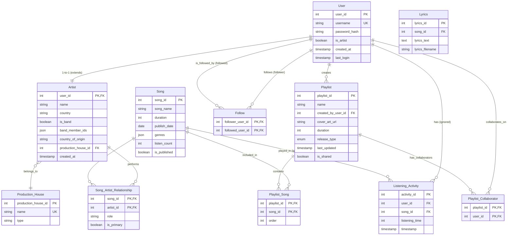

| Table | Fields |
| :--- | :--- |
| **User** | `user_id` (PK), `username` (unique), `password_hash`, `is_artist` (bool), `created_at`, `last_login` |
| **Artist** | `user_id` (PK, FK→User), `name` (string, required), `country` (string, indexed), `is_band` (bool), `band_member_ids` (JSON, nullable), `country_of_origin` (string, nullable), `production_house_id` (FK→Production_House), `created_at` |
| **Production_House** | `production_house_id` (PK), `name` (unique), `type` (string) |
| **Song** | `song_id` (PK), `song_name` (required), `duration` (int), `publish_date` (date), `genres` (JSON), `listen_count` (int, default 0), `is_published` (bool) |
| **Song_Artist_Relationship** | `song_id` (FK→Song), `artist_id` (FK→Artist.user_id), `role` (string), `is_primary` (bool) – Composite PK |
| **Playlist** | `playlist_id` (PK), `name` (required), `created_by_user_id` (FK→User), `cover_art_url` (string, nullable), `duration` (int, total seconds), `release_type` (Enum: 'Single','EP','Album' **OR NULL**), `last_updated`, `is_shared` (bool, default false) |
| **Playlist_Song** | `playlist_id` (FK→Playlist), `song_id` (FK→Song), `order` (int) – Composite PK |
| **Playlist_Collaborator** | `playlist_id` (FK→Playlist), `user_id` (FK→User) – Composite PK. (This table stores users who have edit/view access besides the creator. The creator is inferred from `Playlist.created_by_user_id`). |
| **Follow** | `follower_user_id` (FK→User), `followed_user_id` (FK→User) – Composite PK. |
| **Listening_Activity** | **(IGNORE for implementation)** – Keep the tables in `backend/db/schema.sql` but do not seed them or create APIs for them (`Listening_Activity` is only written by `POST /api/songs/:id/listen`). |
| **Lyrics** | **(IGNORE for implementation)** – Keep the tables in `backend/db/schema.sql` but do not seed them or create APIs for them (`Listening_Activity` is only written by `POST /api/songs/:id/listen`). |

---

#### Mermaid ER Diagram (Crow’s Foot Notation)

---
